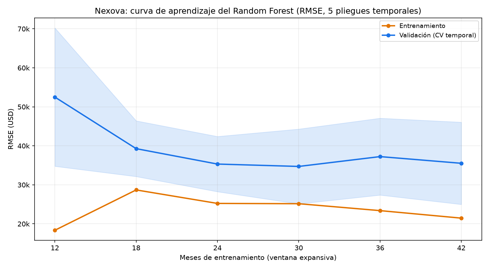

# Evaluación técnica del modelo de pronóstico de ventas — Nexova

Modelo evaluado: Random Forest a 12 meses vista (`n_estimators=500`, `max_depth=5`, `min_samples_leaf=6`) sobre el cociente interanual `revenue_usd(t) / revenue_usd(t-12)`, con features causales de lag, estadísticas rodantes y calendario (agosto, enero–febrero). Todos los errores están en **USD de ingreso mensual consolidado** (el cociente se reconvierte con `lag_12`).

Alcance: solo el set de entrenamiento 2016-2023 (72 filas con features completas, 2018-01 a 2023-12). El test 2024-2025 no se ha usado. Reproducible con `uv run --project services/api --group ml python scripts/evaluate_sales_forecast.py` (cifras en `cv_metrics.json`, curva en `learning_curve.png`).

## Respuesta al ticket

| Pregunta | Respuesta |
|---|---|
| 1. ¿Underfitting, overfitting o bien ajustado? | **Bien ajustado**, con una brecha moderada entre entrenamiento y validación (1,7×) que apunta a algo de varianza residual, no a un sobreajuste problemático. |
| 2. ¿Qué tan estable es? | **Estabilidad media-baja**: el RMSE de validación varía entre 23 k y 45 k USD según el pliegue (38,2 k ± 9,6 k, un 25 % de variación relativa). Con 72 filas y bloques de 6 meses, esa dispersión es esperable, pero hay que tenerla en cuenta. |
| 3. Acción correctiva | **Regularizar más el Random Forest** ampliando la rejilla de ajuste hacia `min_samples_leaf` mayores (8–12 o más), porque el valor actual (6) está en el borde de la rejilla. **No** añadir más datos ni más complejidad (ver §5). |

## 1. Validación cruzada temporal (5 pliegues)

`TimeSeriesSplit(n_splits=5, test_size=6)`: ventana expansiva, sin barajar. Cada pliegue entrena con los meses más antiguos y valida con los 6 meses siguientes.

- **Orden cronológico verificado** en cada pliegue (`assert_chronological`): índices crecientes, toda la validación posterior al entrenamiento y pliegues que avanzan en el tiempo. Lo cubre `tests/pipelines/test_sales_forecast_cv.py`.
- **Sin fuga de lag/rolling entre fronteras de pliegue** (`check_fold_feature_leakage`): en cada pliegue se recalculan las features con la serie cortada en el último mes de entrenamiento y en el último mes de validación; las filas coinciden exactamente con las de la serie completa. Resultado: sin fuga en los 5 pliegues. Es coherente con el diseño causal de las features (`shift >= 12`).

| Pliegue | Train (meses) | Validación | MAE train | MAE val | RMSE train | RMSE val | RMSE naive |
|---|---|---|---|---|---|---|---|
| 1 | 42 (2018-01 → 2021-06) | 2021-07 → 2021-12 | 17.793 | 36.138 | 21.457 | 45.280 | 47.040 |
| 2 | 48 (→ 2021-12) | 2022-01 → 2022-06 | 18.351 | 21.920 | 22.715 | 23.111 | 46.500 |
| 3 | 54 (→ 2022-06) | 2022-07 → 2022-12 | 17.370 | 40.549 | 21.616 | 44.824 | 44.931 |
| 4 | 60 (→ 2022-12) | 2023-01 → 2023-06 | 18.316 | 29.933 | 22.932 | 33.934 | 40.151 |
| 5 | 66 (→ 2023-06) | 2023-07 → 2023-12 | 18.846 | 38.947 | 23.478 | 43.723 | 55.964 |

“Naive” = año pasado × crecimiento interanual medio del train del pliegue.

**Media ± desviación estándar entre pliegues (USD):**

| Métrica | Entrenamiento | Validación | Naive (validación) |
|---|---|---|---|
| MAE | 18.135 ± 567 | **33.497 ± 7.634** | 40.927 ± 7.829 |
| RMSE | 22.439 ± 872 | **38.174 ± 9.623** | 46.917 ± 5.740 |
| RMSE en % del ingreso medio del train (813.551 USD) | 2,76 % | 4,69 % | 5,77 % |

## 2. Curva de aprendizaje

RMSE medio (USD) por tamaño de train, promediado sobre los mismos 5 bloques de validación (solo tamaños presentes en todos los pliegues, hasta 42 meses, para no mezclar “más datos” con “otro periodo de validación”):

| Meses de train | 12 | 18 | 24 | 30 | 36 | 42 |
|---|---|---|---|---|---|---|
| RMSE train | 18.347 | 28.690 | 25.231 | 25.158 | 23.384 | 21.457 |
| RMSE validación | 52.501 | 39.274 | 35.323 | 34.713 | 37.234 | 35.521 |

Lectura del patrón:

- El error de validación cae con rapidez hasta ~24 meses (52,5 k → 35,3 k) y **desde ahí se estanca** en torno a 35 k–37 k (24 → 42 meses: +0,6 %). Más datos, con esta estructura, no están reduciendo el error.
- El error de entrenamiento se mantiene **bajo y estable (≈21–25 k)**, alrededor de un 2,8 % del ingreso medio. No es cercano a cero: el modelo no memoriza el ruido (`max_depth=5` y `min_samples_leaf=6` lo impiden). Ese nivel es compatible con la fluctuación de ±5 % mensual que describe el briefing (interpretación, no medición directa).
- Las curvas **no convergen del todo**: queda una brecha persistente de ~1,7× (RMSE) al tamaño máximo común. Un Random Forest siempre ajusta mejor sus propios datos que los nuevos, por lo que esa brecha es en parte estructural, pero es lo bastante estable como para señalar varianza residual moderada.
- No hay underfitting: el error de entrenamiento es solo el 48 % del error de validación del naive, y el de validación (38,2 k) es un 19 % mejor que el del naive (46,9 k).

## 3. Diagnóstico: **bien ajustado**

Evidencia a favor:

1. Error de entrenamiento bajo pero no nulo (2,8 % del ingreso medio): sin memorización.
2. Error de validación (4,7 %) mejor que el naive (5,8 %) en la media y en los 5 pliegues, aunque en los pliegues 1 y 3 la ventaja es mínima (ver §4).
3. Brecha 1,7×, por debajo del umbral orientativo de sobreajuste (2×) que fija `evaluation.diagnose`, y la curva de validación es estable, no creciente, al añadir datos.
4. Como referencia (no usada para decidir): el error en el test 2024-2025 fue RMSE 31.011 USD (3,23 %) y MAE 26.917 USD, mejor que la media de la validación cruzada, sin señales de que el modelo esté ajustado al periodo de validación.

Matiz: la brecha moderada y la dispersión entre pliegues muestran que el modelo tiene algo de varianza que se puede reducir (ver §5). Por eso la acción correctiva no es “ninguna”.

## 4. Estabilidad

El RMSE de validación por pliegue va de 23.111 a 45.280 USD (desviación estándar 9.623, un 25 % de la media). Dos observaciones:

- El pliegue 2 (ene–jun 2022) es mucho mejor (RMSE val ≈ RMSE train) que los demás. En los pliegues 1 y 3 (jul–dic de 2021 y 2022) el modelo apenas supera al naive (45,3 k vs 47,0 k; 44,8 k vs 44,9 k). Los bloques que contienen agosto (caída del 15–25 %) y los cambios del crecimiento anual (alterna entre 1 % y 7 % según el briefing) parecen ser lo más difícil de anticipar. **Es una hipótesis** que habría que confirmar con residuos por mes; no se ha medido.
- Con 6 meses por bloque de validación, un solo mes atípico mueve mucho el RMSE del pliegue. La dispersión refleja en parte el tamaño de los bloques y no solo la inestabilidad del modelo.

## 5. Acción correctiva

**Ampliar la rejilla de `tune_random_forest` hacia más regularización y volver a evaluar con este mismo esquema.** Razones basadas en la evidencia:

- El mejor `min_samples_leaf` de la rejilla actual (`[2, 4, 6]`) es el **valor máximo**: el óptimo podría estar fuera de la rejilla (`data/pipelines/sales_forecast/model.py`, `RF_PARAM_GRID`).
- La curva muestra varianza residual (brecha persistente) y no sesgo (error de train bajo) ni falta de datos (validación estancada). Eso descarta “aumentar la complejidad” (no hay underfitting) y “más datos” como primera respuesta (la validación no mejora de 24 a 42 meses).
- Comprobación exploratoria en este mismo CV de 5 pliegues (solo train, **no aplicada** al modelo ni al código; la elección de hiperparámetros sobre el mismo CV es ligeramente optimista):

| Configuración | RMSE train | RMSE val (media ± std) | MAE val | Brecha val/train |
|---|---|---|---|---|
| `min_samples_leaf=6` (actual) | 22.439 | 38.174 ± 9.623 | 33.497 | 1,70 |
| `min_samples_leaf=8` | 24.930 | 37.013 ± 9.267 | 32.617 | 1,48 |
| `min_samples_leaf=10` | 26.833 | 36.295 ± 9.110 | 31.858 | 1,35 |
| `min_samples_leaf=12` | 27.964 | 35.794 ± 8.497 | 31.481 | 1,28 |
| `min_samples_leaf=6` + `max_features=0,5` | 23.425 | 39.210 ± 7.287 | 35.257 | 1,67 |

Más hojas mínimas reduce la brecha y mejora algo la validación (≈ −6 % de RMSE de 6 a 12), y la mejora no se ha agotado en 12. Limitar `max_features` baja la dispersión entre pliegues pero no el error medio, así que no se prioriza.

Pasos propuestos: (1) añadir `min_samples_leaf` ∈ {8, 10, 12, 16} (y alguna `max_depth` menor) a `RF_PARAM_GRID`; (2) re-ajustar con el CV de `tune_random_forest` y re-ejecutar esta evaluación; (3) adoptar el cambio solo si baja el RMSE de validación sin subir el error de entrenamiento más allá de la brecha ganada; (4) volver a medir en el test 2024-2025 una sola vez al final. La mejora esperada es modesta: el modelo ya está bien ajustado.

## 6. Métrica principal: RMSE (MAE como complemento)

- **MAE** es el error típico en dólares y es fácil de explicar a Marcos (Ventas).
- **RMSE** eleva al cuadrado los errores, así que penaliza más las desviaciones grandes. Para Nexova eso importa: Laura necesita distinguir un mes flojo esperado (agosto) de una caída anómala, y una desviación grande en un mes mal pronosticado es lo que descuadra el presupuesto o esconde una anomalía real. El briefing además pide el MSE como KPI (en USD² y como % del ingreso medio), y el RMSE es su raíz en USD.
- **Limitación:** el briefing no dice si es más caro sobreestimar o subestimar las ventas. Esta justificación se apoya en la necesidad de detectar desviaciones grandes, no en un coste asimétrico conocido. Si negocio confirma que un sentido pesa más, habría que añadir una métrica asimétrica (por ejemplo, error con signo o pérdida cuantílica).
- En esta evaluación ambas métricas cuentan la misma historia (el RMSE val es 1,14× el MAE val; el diagnóstico no cambia con cualquiera de ellas).

## 7. Limitaciones

- Solo 72 filas con features completas y bloques de validación de 6 meses: poca potencia estadística y media de pliegues ruidosa. Con `test_size=12` no caben 5 pliegues.
- Los tamaños de train de 54–66 meses solo existen en 1–4 pliegues y se han excluido de la curva para no mezclar periodos de validación; el tamaño completo de cada pliegue sí está en la tabla de la §1.
- Los hiperparámetros se eligieron con un CV distinto (4 pliegues × 12 meses) sobre el mismo train, por lo que las cifras de validación pueden ser algo optimistas.
- Los umbrales de `evaluation.diagnose` (2× de brecha, 0,8 × naive, 5 % de convergencia) son heurísticos; el diagnóstico final se apoya en la curva y en el contexto, no solo en ellos.
