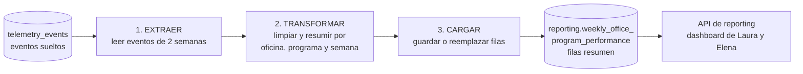

# Diseño del Pipeline de Desempeño de Negocio — Nexova

> **Estado:** diseño (Parte 1 de 3), sin código de orquestación.
> **Entregable:** "Reporte Semanal de Desempeño por Oficina y Programa" para Laura (CEO) y Elena (L&D), fresco los lunes.
> **Fuente:** `public.telemetry_events` (solo lectura). **Destino:** esquema `reporting`.

## 0. Decisiones

| # | Decisión | Motivo |
|---|----------|--------|
| D1 | `cost_variance_events_count` cuenta solo subidas (`value > 0`). | El KPI habla de subidas; la captura emite con `abs(variance_pct) > 10` y no se toca. |
| D2 | `programme_id` nulo → `'unassigned'`. | `Asset.programme_id` es nullable pero forma parte de la clave `unique`. |
| D3 | Módulo en `services/api/reporting/` (no `services/reporting/`). | La API vive en `services/api/`, junto a `telemetry/`. |
| D4 | `unit_cost` nulo se excluye del costo y se cuenta en el log. | Tratarlo como 0 ocultaría datos faltantes. |
| D5 | Cada corrida recalcula la semana actual y la anterior. | La fuente no guarda hora de ingesta; así se absorben eventos tardíos. |
| D6 | Lock por pipeline en `reporting.pipeline_runs`: una sola corrida `running` a la vez. | Cron y disparo manual pueden tener ventanas distintas pero tocan las mismas filas; un lock por ventana no las protegería. |
| D7 | Endpoints con `get_current_user`; restricción a admin como TODO. | Igual que `/telemetry/report`; no existen admins. |
| D8 | `kits_delivered_count` es el **conteo de eventos** `outbound_order_created` (no `Σ quantity`), sin filtrar por categoría ni `exit_type`. | Es la definición literal del CONTEXT. Las unidades entregadas (`Σ quantity`) quedan para v2 como columna aparte, para no mezclar ambos números. |

## 1. Estado actual y brecha

**Captura.** El catálogo `docs/telemetry/event-schemas.json` define 27 eventos. Los de negocio los emite `services/api/routers/inventory.py` vía `log_telemetry_event`: `inbound_order_created` (`unit_cost`, `quantity`), `outbound_order_created`, `stock_threshold_triggered` (edge-triggered, sin `currency`) y `kit_cost_variance_detected` (`variance_pct`), todos con `office` y `programme_id`.

**Almacenamiento.** `public.telemetry_events` (migración `002_telemetry_events.sql`): `id`, `timestamp` (ocurrencia), `service`, `event_type`, `level`, `value`, `message`, `tags` (JSONB). Es append-only (triggers) y deduplica por `tags->'_envelope'->>'eventId'` (`ON CONFLICT DO NOTHING`). `office`, `programme_id`, `unit_cost` y `quantity` están dentro de `tags`.

**Reporte técnico existente.** `GET /telemetry/report` (`services/api/telemetry/analysis.py`) responde para ingeniería: eventos por día, tasa de error por tipo y fallos de login. **No se modifica.**

**Brecha.** Nadie puede responder, por oficina, programa y semana: cuánto se gastó en material, cuántos kits se entregaron, cuántas veces cayó el stock bajo el mínimo y cuántas veces subió el costo de un proveedor. Tampoco hay semanas ISO cerradas ni monedas separadas (`EUR`/`USD`).

## 2. Propósito

> Producir cada lunes el "Reporte Semanal de Desempeño por Oficina y Programa" para Laura y Elena, calculando por `office` × `programme_id` × semana ISO el **costo de material**, los **kits entregados**, la **frecuencia de escasez** y la **frecuencia de variación de costo**, a partir de `inbound_order_created`, `outbound_order_created`, `stock_threshold_triggered` y `kit_cost_variance_detected`.

| Campo destino | Evento | Cálculo |
|---------------|--------|---------|
| `total_material_cost` | `inbound_order_created` | `Σ(unit_cost × quantity)` con `unit_cost` no nulo |
| `kits_delivered_count` | `outbound_order_created` | conteo de eventos |
| `shortage_events_count` | `stock_threshold_triggered` | conteo |
| `cost_variance_events_count` | `kit_cost_variance_detected` | conteo con `value > 0` |

`currency` se deriva de `office` (`valencia` → `EUR`, `miami` → `USD`), como en `routers/inventory.py`. Nunca se convierten ni suman monedas.

## 3. Extracción

Consulta de solo lectura, ventana `[start, end)` UTC, filtrada por los 4 `event_type`. La ventana es la semana ISO actual y la anterior (`lookback_weeks=2`, ampliable en backfill). Cadencia: lunes `04:00 UTC` más disparo manual.

```sql
SELECT "timestamp", event_type, value,
       tags ->> 'office'                    AS office,
       NULLIF(tags ->> 'programme_id', '')  AS programme_id,
       (tags ->> 'unit_cost')::numeric      AS unit_cost,
       (tags ->> 'quantity')::int           AS quantity,
       (tags ->> 'order_id')::int           AS order_id,
       tags -> '_envelope' ->> 'eventId'    AS event_id
FROM public.telemetry_events
WHERE "timestamp" >= :window_start AND "timestamp" < :window_end
  AND event_type IN ('inbound_order_created', 'outbound_order_created',
                     'stock_threshold_triggered', 'kit_cost_variance_detected');
```

`kit_cost_variance_detected` guarda `variance_pct` en `value`, así que D1 no necesita leer el JSONB.

## 4. Flujo de datos



En cada etapa el pipeline anota su avance en `reporting.pipeline_runs` (bitácora y lock de la corrida, ver §7).

**Reglas de transformación.** `week_start` es el lunes 00:00 UTC (`timestamp` convertido con `utc=True`). Solo `valencia` y `miami`; otros valores se descartan y se cuentan. Se deduplica por `event_id` en todos los eventos y, solo en `inbound_order_created`, `outbound_order_created` y `kit_cost_variance_detected` (que sí traen `order_id`), también por `(event_type, order_id)`. `stock_threshold_triggered` no lleva `order_id` y se deduplica solo por `event_id`. Las combinaciones sin eventos no generan fila.

## 5. Registros actualizados (upsert)

La fuente es append-only; lo que cambia es el agregado, que se recalcula cada corrida. Estrategia: upsert sobre `unique (office, programme_id, week_start)` **reemplazando** valores (nunca sumando):

```sql
INSERT INTO reporting.weekly_office_program_performance (...)
VALUES (...)
ON CONFLICT (office, programme_id, week_start) DO UPDATE SET
    total_material_cost        = EXCLUDED.total_material_cost,
    kits_delivered_count       = EXCLUDED.kits_delivered_count,
    shortage_events_count      = EXCLUDED.shortage_events_count,
    cost_variance_events_count = EXCLUDED.cost_variance_events_count,
    currency = EXCLUDED.currency, computed_at = now();
```

## 6. Tablas y endpoints

**Tablas** (migración manual `003_reporting_schema.sql`, fuera de `SQLModel.metadata` como la 002):
- `reporting.weekly_office_program_performance`: el DDL del CONTEXT, sin cambios.
- `reporting.pipeline_runs`: log de corridas (§7.3), con índice único parcial `(pipeline_name) WHERE status = 'running'`.

**Endpoints** en `services/api/reporting/` (con `response_model`). Ninguno toca `analysis.py` ni `/telemetry/report`:

| Endpoint | Función | Función en `data/pipelines/` |
|----------|---------|------------------------------|
| `GET /reporting/pipeline-runs/latest` | Estado de la última corrida (`404` si no hay) | `get_latest_run()` |
| `POST /reporting/pipeline-runs` | Disparo manual (`week_start` opcional); `202` con `run_id`, `409` si el lock está tomado | `run_weekly_performance_pipeline(trigger="manual")` |
| `GET /reporting/weekly-office-program-performance` | KPIs (`week_start` opcional, debe ser lunes; por defecto la última calculada) | `query_weekly_kpis(week_start)` |

La respuesta de KPIs es la del CONTEXT (`week_start` + `entries[]` con `office`, `programme_id`, los 4 contadores y `currency`). Usa `cache.get_or_set` (TTL 60 s), invalidado al terminar la carga. La lógica ETL vive en `data/pipelines/business_performance/`; `services/` solo importa de ahí.

## 7. Resiliencia

### 7.1 Idempotencia

1. **Origen:** `telemetry_events` ya deduplica por `eventId`; el pipeline añade `drop_duplicates` por `event_id` y, solo en los 3 eventos con `order_id`, por `(event_type, order_id)`. Nunca se aplica sobre `order_id` nulo: colapsaría eventos distintos.
2. **Cálculo:** cada corrida recalcula la ventana completa desde la fuente, sin acumular.
3. **Carga:** upsert con reemplazo en una sola transacción.

### 7.2 Segunda corrida tras un fallo en la carga

Si la carga falla tras 847 de 1 412 filas, la transacción hace rollback y la tabla queda como estaba; la corrida queda `failed` con `phase = 'load'`. La siguiente corrida abre un `run_id` nuevo, relee la fuente y hace upsert de las 1 412 filas, con el mismo resultado que una corrida limpia. Si en el futuro la carga se parte en lotes, las filas ya escritas se sobrescriben con los mismos valores (`= EXCLUDED`) y el resultado converge igual. Una corrida `running` de más de 15 min se marca `failed` (`stale run`) antes de tomar el lock.

**Eventos tardíos:** se absorben al recalcular la semana actual y la anterior. `computed_at` deja el rastro (se contrasta con `started_at`/`finished_at` de `pipeline_runs`), y `rows_revised > 0` en una semana cerrada señala un evento tardío. Más allá de 2 semanas se requiere backfill manual.

**Concurrencia:** `open_run` inserta una fila `running`; el índice único parcial por `pipeline_name` rechaza la segunda, aunque su ventana sea distinta. Esa corrida termina `skipped` (cron) o `409` (manual). El lock es por pipeline y no por ventana porque cron y disparo manual pueden recalcular semanas distintas que comparten filas.

### 7.3 Log de ejecución — `reporting.pipeline_runs`

| Campo | Tipo | Para qué sirve en auditoría |
|-------|------|-----------------------------|
| `run_id` | `uuid` PK | Identifica la corrida de forma única. |
| `pipeline_name` | `text` | Clave del lock (una corrida `running` por pipeline); permite reutilizar la tabla. |
| `trigger` | `text` (`schedule`/`manual`) | Distingue cron de disparo humano. |
| `window_start`, `window_end` | `timestamptz` | Ventana procesada; permite saber qué semanas se recalcularon. |
| `started_at`, `finished_at` | `timestamptz` | Duración y detección de corridas zombi (`finished_at` nulo). |
| `status` | `text` (`running`/`completed`/`failed`/`skipped`) | Estado que consulta `/pipeline-runs/latest`. |
| `phase` | `text` (`extract`/`transform`/`load`) | Checkpoint: dónde falló. |
| `rows_read` | `integer` | Eventos leídos; `0` con `completed` distingue "sin actividad" de "no corrió". |
| `rows_written`, `rows_revised` | `integer` | Filas escritas y filas ya publicadas que cambiaron (eventos tardíos). |
| `rows_missing_cost`, `rows_unassigned_programme`, `rows_invalid_office`, `rows_duplicates_dropped` | `integer` | Calidad de dato (D4, D2, oficina inválida, duplicados). |
| `error_message` | `text` nulo | Causa del fallo. |
| `prefect_flow_run_id` | `text` nulo | Enlace con los logs de Prefect. |

## 8. Mapeo a Prefect

**Flow principal:** `weekly_office_program_performance_flow` (parámetros `week_start`, `lookback_weeks=2`, `trigger`). Flow opcional de backfill por rango de semanas.

**Tasks:** `open_run` (toma el lock) → `extract_events` (`retries=3`) → `transform_weekly_aggregates` (pura, sin I/O) → `load_weekly_performance` (`retries=3`, seguro por idempotencia) → `close_run` (cierra el log e invalida la caché; corre también ante fallo).

**States:** `Running` → `running`; `Completed` → `completed`; `Failed` → `failed`; `Retrying` sigue en `running`; `Crashed` queda `running` y se limpia por antigüedad.

**Blocks:** `Secret` `nexova-database-url` (hoy `DATABASE_URL` en `services/api/database.py`) y `JSON` `reporting-pipeline-config` (`lookback_weeks`, lista de `event_type`, ventana de obsolescencia). Deployment con cron `0 4 * * 1` (UTC). En v1 el `POST` invoca la función del flow directamente en `BackgroundTasks`.

## 9. Preguntas de diseño

1. **Duplicados en origen:** la clave es `eventId` (envelope), aplicada en la **ingesta** con índice único + `ON CONFLICT DO NOTHING`. Los agregados cuentan después de deduplicar; para los eventos con `order_id` también por `(event_type, order_id)`.
2. **Reintento tras fallo:** §7.2; rollback de la transacción y upsert con reemplazo.
3. **Eventos tardíos:** §7.2; recalculo de dos semanas y `rows_revised`.
4. **Silencio vs. ausencia:** toda corrida `completed` deja fila en `pipeline_runs`, incluso con `rows_read = 0`; sin fila, el pipeline no corrió. Un cero de negocio se contrasta con la actividad de sesiones (`backoffice_section_viewed`, `login_succeeded`): cero eventos de todo tipo sugiere captura caída. Heartbeat explícito: Parte 2.
5. **Trazabilidad:** `eventId` → ventana de la corrida (`window_start/end`) → `run_id`; la fila del reporte se enlaza con su corrida por `computed_at`. Los eventos de inventario se emiten con `request_id=None`, así que `requestId` no sirve para correlacionar; se usa ventana y conteos.
6. **Crecimiento vs. pérdida:** se compara el volumen con las sesiones activas y las oficinas que reportan. Riesgo: `log_telemetry_event` nunca lanza, así que un fallo de Supabase pierde el evento sin rastro.
7. **Caída de DB:** checkpoint en `pipeline_runs.phase`. No se persisten resultados intermedios; la siguiente corrida recalcula todo.
8. **Buffer en frontend:** los 4 eventos del pipeline son `source = backend`, así que no dependen del buffer del navegador. Para los de frontend, el servidor deduplica por `eventId`.
9. **Reintento de transmisión:** `eventId` hace de clave de idempotencia. `POST /telemetry/events` responde `200` (no reintentar) o `503` (reintentar).
10. **Corridas concurrentes:** §7.2; índice único parcial por pipeline (una corrida `running` a la vez) y `run_id` único.

## 10. Riesgos y decisiones abiertas

**Huecos del repo (Parte 2):** `data/` no está montado en Docker (`context: ./services`); Prefect no está en las dependencias; `services/api/data/` colisiona con un paquete llamado `data`, por eso se propone `business_performance` importado vía `sys.path`; no existen admins; `office` es texto libre.

**Abierta:**
- **A1.** La semana es UTC (regla del CONTEXT): un evento del lunes de madrugada hora local puede caer en la semana anterior.

**Restricciones cumplidas:** no se modifica `analysis.py` ni `GET /telemetry/report`; no se escribe en `telemetry_events`; no hay campos nuevos en la captura; no se mezclan monedas.
