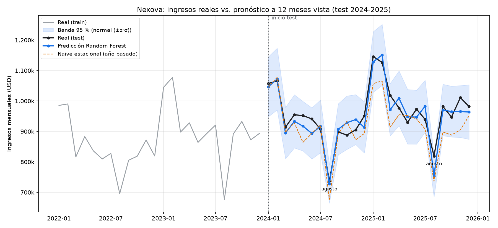

# Pronóstico mensual de ingresos (`sales_forecast`)

Responde a la pregunta del BRIEFING de Nexova: **¿se pueden predecir los ingresos de los próximos meses con un error aceptable?** Con los datos provistos, sí: a 12 meses vista, el Random Forest se equivoca de media un **2,85 %** al mes (26.917 USD) en 2024-2025, frente al 4,98 % de "repetir el año pasado".

## Cómo ejecutarlo

```bash
# Entrenar y evaluar (≈ 30 s). Escribe en data/eval/sales_forecast/
uv run --project services/api --group ml python scripts/train_sales_forecast.py

# Tests (split 8/2, features sin fuga y métricas)
uv run --project services/api --group ml pytest tests/pipelines
```

Las dependencias de ML (`scikit-learn`, `xgboost`, `matplotlib`, `scipy`) están en el grupo `ml` de `services/api/pyproject.toml`. No entran en `requirements.txt`, así que la imagen Docker de la API no cambia. La salida es determinista (`random_state=42`): dos ejecuciones dan archivos idénticos.

## Datos y split

- `data/raw/nexova_sales.csv`: 120 meses (`2016-01-01` → `2025-12-01`), solo fila `consolidated`, sin nulos ni huecos. `dataset.validate_schema` comprueba las columnas del BRIEFING, que no haya nulos, que `revenue_usd > 0` y que los meses sean continuos; si algo falla, lanza un error en vez de corregir los datos.
- **Train:** `2016-01` → `2023-12` (96 meses). **Test:** `2024-01` → `2025-12` (24 meses). El corte es `primer mes + 8 años` y no depende del orden de las filas (`tests/pipelines/test_sales_forecast_split.py`).

## Enfoque

**Horizonte:** pronóstico directo a **12 meses vista**. Para el mes `t` solo se usa información de `t-12` o anterior, lo que sirve para presupuestar el año siguiente.

**Target:** el cociente interanual `r_t = y_t / y_{t-12}`. El ingreso del test está por encima de todo el rango del train (crecimiento medio del 4 % anual) y los árboles no extrapolan, mientras que el cociente es estable. El ingreso se reconstruye como `r̂_t · y_{t-12}`.

**Features** (`features.py`, todas con `shift ≥ 12`):

| Feature | Qué capta |
|---|---|
| `month_of_year`, `quarter`, `is_august`, `is_jan_feb` | estacionalidad del BRIEFING (agosto −15/−25 %, enero-febrero +15/+20 %) |
| `lag_12`, `lag_13`, `lag_24` | nivel del mismo mes en los años anteriores |
| `yoy_ratio_lag12` | crecimiento del año pasado; como el crecimiento alterna entre ~1 % y ~7 %, es la feature más importante |
| `roll_mean_12_lag12`, `roll_std_12_lag12`, `seasonal_index_lag12` | nivel, volatilidad y peso estacional del año previo |
| `contracts_lag12`, `acv_lag12` | drivers de negocio conocidos a 12 meses vista |

**Sin fuga de datos:**
- Las features de los meses de train solo leen meses de train.
- Las del test leen datos reales de 2023-2024, que a 12 meses vista ya son pasado, pero el modelo nunca se ajusta con ellas.
- El ajuste de hiperparámetros y la calibración de la banda usan solo el train.
- Lo cubren dos tests de `tests/pipelines/test_sales_forecast_features.py`.

**Nulos y escalado:**
- Los primeros 24 meses no tienen historia suficiente y se descartan, no se imputan. Quedan 72 filas de train (2018-2023).
- No se escala ninguna variable: un Random Forest es invariante a transformaciones monótonas de las features, y la normalización que importa ya la hace el target en cociente.

## Por qué Random Forest

- **Tamaño de los datos:** con 72 filas, un Random Forest promedia cientos de árboles y sobreajusta poco sin necesidad de afinarlo. XGBoost necesita ajustar learning rate, profundidad y regularización con un CV temporal muy ruidoso. Como referencia, el `XGBRegressor` entrenado con parámetros razonables queda por detrás (MAPE 3,08 % frente a 2,85 %).
- **Explicabilidad para Finanzas:** "la media de 500 árboles de decisión", con importancias por permutación (`metrics.json → feature_importance`).
- **Tiempo de ajuste:** segundos en ambos modelos, así que no decide.
- **Hiperparámetros:** grid de 18 combinaciones con `TimeSeriesSplit` de 4 pliegues; cada pliegue valida un año natural completo (2020-2023). El mejor resultado es `n_estimators=500`, `max_depth=5` y `min_samples_leaf=6`, con un MAE de CV de 31.161 USD.

## Resultados en el test (2024-2025)

| Modelo | MSE (USD²) | RMSE % ingreso medio | MAE (USD) | MAPE | R² | Gini normalizado |
|---|---|---|---|---|---|---|
| **Random Forest** | **961.675.990** | **3,23 %** | **26.917** | **2,85 %** | **0,871** | **0,907** |
| XGBoost (referencia) | 1.264.764.409 | 3,71 % | 28.782 | 3,08 % | 0,830 | 0,887 |
| Naive con crecimiento medio | 1.691.510.729 | 4,29 % | 34.135 | 3,59 % | 0,773 | 0,797 |
| Naive estacional (año pasado) | 3.190.168.976 | 5,89 % | 47.590 | 4,98 % | 0,572 | 0,797 |

| Métrica | Valor | Lectura |
|---|---|---|
| PSI `avg_contract_value_usd` | 0,480 (p permutación = 0,089) | Supera el umbral de 0,25: en el test hay más meses con contratos de alto valor (11 de 24 en el quintil superior del train). Con 24 meses el PSI tiene un suelo alto por ruido y la prueba de permutación no lo confirma al 5 %. **Se reporta como señal a vigilar** |
| PSI target (cociente interanual) | 0,068 (p = 0,885) | Estable: la dinámica de crecimiento y estacionalidad del test es la misma que aprendió el modelo |
| K² residuos del test | 1,78, p = 0,410 (n = 24) | Compatibles con la normal: sin sesgo ni colas raras (poca potencia con n = 24) |
| K² residuos fuera de muestra (CV) | 0,18, p = 0,915 (n = 48) | Normales, así que la banda se construye como ±1,96 σ |
| Cobertura de la banda del 95 % | 100 % (24/24), ancho medio ±9,1 % | Honesta y algo conservadora: se calibró con pliegues entrenados con menos historia |



## Las métricas

- **MSE:** `mean((y − ŷ)²)`, en USD². El BRIEFING lo pide también como porcentaje del ingreso medio. Como `MSE / media` no tiene unidades coherentes, se da `RMSE / media` (3,23 %) y, aparte, `MSE / media²`.
- **PSI:** `Σ (q − p) · ln(q / p)`, con 5 tramos definidos por los cuantiles del train y ε = 1e-4 en los tramos vacíos. Umbrales: menos de 0,10 es estable, de 0,10 a 0,25 conviene vigilar, y más de 0,25 es un cambio significativo. Se acompaña de un p-valor por permutación porque, con 24 meses, el PSI sale alto aunque no haya cambio. El CSV no desglosa las líneas de negocio, así que el mix se aproxima con `avg_contract_value_usd`.
- **Gini normalizado:** `G(y, ŷ) / G(y, y)`, donde `G` es el área entre la curva de ingreso acumulado (ordenando por la predicción) y la diagonal. Vale 1 si el modelo ordena los meses igual que la realidad. Mide si distingue un agosto flojo de un mes bueno.
- **K² (D'Agostino-Pearson):** `Z(asimetría)² + Z(curtosis)² ~ χ²(2)`, calculado con `scipy.stats.normaltest`. Un p > 0,05 indica que los residuos son compatibles con la normal.
- **MAE / MAPE:** las métricas para Finanzas: "nos equivocamos de media X USD, un Y % al mes".

**Por qué un MSE bajo no basta:**
- Está en USD² y depende de la escala.
- Lo dominan unos pocos meses con errores grandes.
- No dice si el modelo mejora a "repetir el año pasado"; para eso están los baselines.
- No detecta un sesgo sistemático; eso lo ve K².
- No dice si el modelo ordena bien los meses; eso lo ve el Gini.
- No avisa de un cambio de régimen; eso lo ve el PSI.

## Banda de variabilidad

`intervals.py` toma los 48 residuos fuera de muestra del CV (solo train, en escala de cociente) y les aplica K². Si son normales, la banda es `r̂ ± 1,96 σ`; si no, usa los cuantiles empíricos del 2,5 % y el 97,5 %. Después se pasa a USD multiplicando por `lag_12`. Como diagnóstico, la dispersión entre árboles del Random Forest (percentiles 2,5–97,5) solo cubre el 83 % del test: subestima la incertidumbre, y por eso no se usa como banda.

## Limitaciones

- El PSI del mix de líneas no se puede calcular de forma directa. Para hacerlo, habría que pedir a Finanzas el desglose por línea de negocio.
- Se entrena con solo 72 filas: las métricas tienen mucha varianza y K² tiene poca potencia con 24 residuos.
- El agosto de 2025 se subestima un 8 % (754k previstos frente a 819k reales), aunque sigue dentro de la banda.
- El modelo solo pronostica a 12 meses vista. A más horizonte habría que encadenar predicciones o usar lags de 24 meses.

## Archivos

| Archivo | Rol |
|---|---|
| `dataset.py` | carga, validación y split (solo pandas) |
| `features.py` | features causales y target |
| `model.py` | baselines, Random Forest con CV temporal, XGBoost de referencia e importancias |
| `intervals.py` | banda calibrada con K² |
| `metrics.py` | MSE, PSI (+ permutación), Gini normalizado, K², MAE/MAPE/R² y cobertura |
| `evaluation.py` | CV temporal de 5 pliegues, curva de aprendizaje, comprobación de fuga y diagnóstico de ajuste |
| `plot.py` | `forecast_test.png`, `residuals_qq.png` y `learning_curve.png` |
| `scripts/train_sales_forecast.py` | CLI que encadena todo |
| `scripts/evaluate_sales_forecast.py` | CLI de la evaluación: escribe `data/eval/cv_metrics.json` y `learning_curve.png` (el informe es `data/eval/evaluation_report.md`) |
