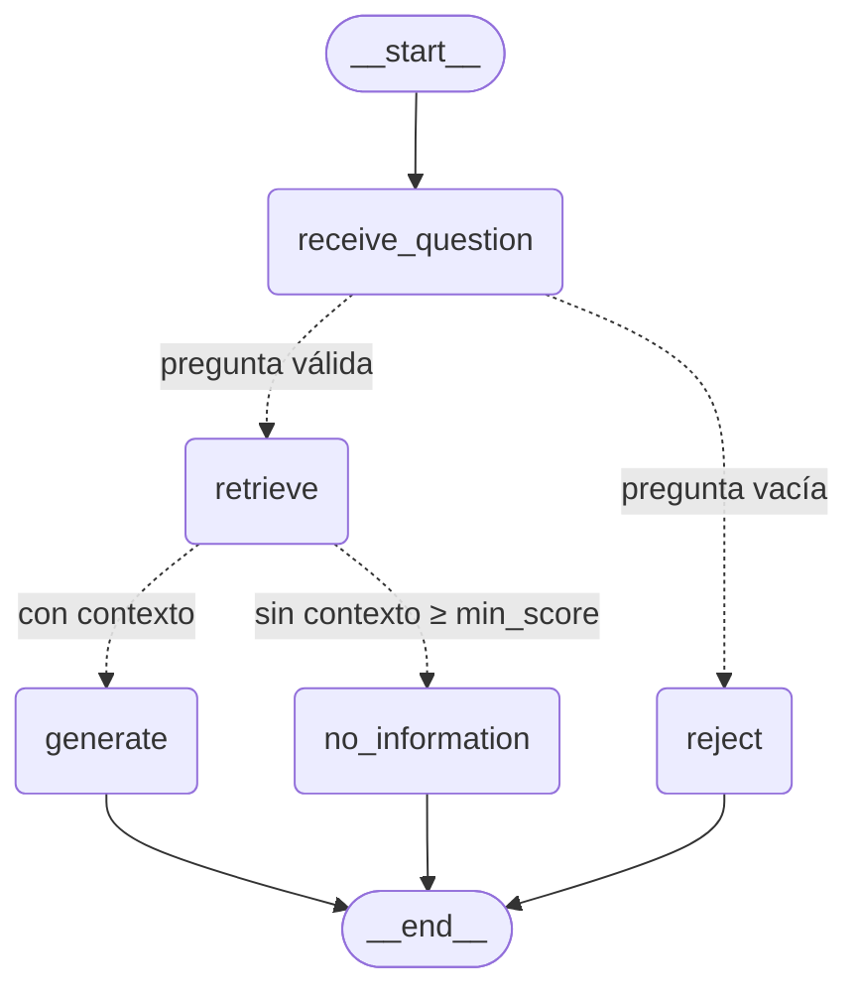
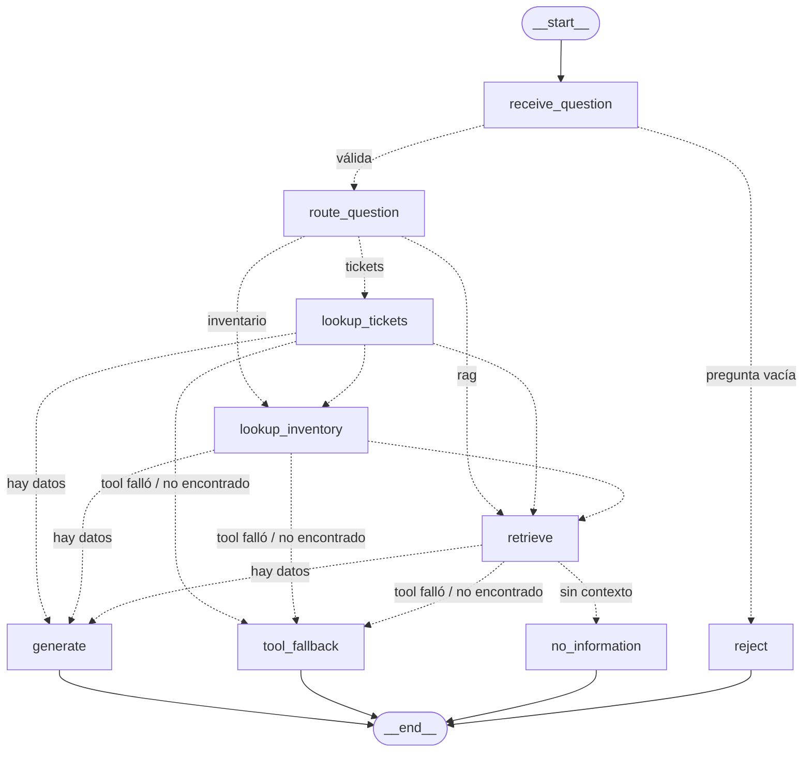
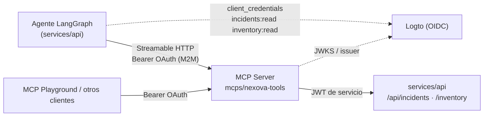

# Agente de soporte con LangGraph — Parte 1: migración y flujo

El RAG de Nexova (`data/pipelines/rag.py`) deja de ser una caja negra: el mismo
comportamiento vive ahora en un grafo de LangGraph con estado, nodos y
transiciones explícitas, checkpoints en SQLite y un trace JSON por corrida.
El RAG no se reescribe: el grafo llama a `retrieve()` y `generate_answer()` del
pipeline a través de `services/api/knowledge/pipeline_bridge.py`.

## Grafo (Parte 1)

> La Parte 2 añade el enrutador y las tools en vivo: ver [Parte 2](#parte-2--herramientas-fuera-del-rag). Las rutas de esta sección siguen existiendo cuando la pregunta solo necesita el RAG.



Diagrama generado con `get_agent_graph().get_graph().draw_mermaid()`. Las etiquetas de las aristas se añadieron a mano.

| Nodo | Responsabilidad | Llama a |
|---|---|---|
| `receive_question` | Normaliza la pregunta (`strip`); si queda vacía marca `error="empty_question"` | — |
| `retrieve` | Recupera los chunks que superan `min_score` (0.30) | `rag.retrieve(question)` |
| `generate` | Genera la respuesta con el contexto **ya recuperado** | `rag.generate_answer(question, context)` |
| `no_information` | Respuesta honesta fija, sin gastar una llamada al LLM | — |
| `reject` | Cierra la corrida con el error de pregunta vacía | — |

Ningún nodo llama a `rag.query()` (recuperación y generación juntas). El eval 4 lo comprueba: en cada corrida hay una sola recuperación, y la generación recibe exactamente el contexto que el trace atribuye a `retrieve`.

## Estado (`services/api/agent/state.py`)

`question`, `context`, `answer` y `error`. **No incluye historial de conversación.** Cada consulta del asistente de ventas es independiente: el RAG tampoco lo usaba y ningún nodo lo lee. Arrastrarlo solo engordaría cada checkpoint. Si la Parte 2 necesita memoria entre turnos, se añadirá con su justificación.

## Compilación

`build_graph()` termina en `compile_graph()`. Esta función compila el grafo y lanza `AgentGraphBuildError` en dos casos:
- **Errores que detecta LangGraph:** una arista hacia un nodo inexistente o un grafo sin punto de entrada.
- **Errores que LangGraph deja pasar:** un nodo inalcanzable desde `START` o sin camino hasta `END`.

La API compila el grafo en su `startup` (`get_agent_graph()`, cacheado), así que un grafo roto impide arrancar en vez de fallar en la primera petición.

## Checkpointing

- **Backend:** `SqliteSaver` (`langgraph-checkpoint-sqlite`), en `services/api/data/agent/checkpoints.sqlite`. La ruta se cambia con `AGENT_CHECKPOINT_PATH`.
- **Identificador:** cada corrida usa `thread_id = run_id`.
- **Inspección:** las transiciones se consultan después con:

```python
from agent.graph import get_agent_graph
from agent.runner import run_config
history = list(get_agent_graph().get_state_history(run_config(run_id)))
```

Una corrida completa deja 5 checkpoints: entrada, `receive_question`, `retrieve`, nodo final y estado terminal.

## Trace

- **Dónde:** `services/api/data/agent/traces/<run_id>.json`. La ruta se cambia con `AGENT_TRACE_DIR`.
- **Contenido:** `run_id`, `question`, `status` (`completed` / `rejected` / `failed`), `nodes` en orden y `final_answer`. Por cada paso: `order`, `node`, `started_at`, `duration_ms`, `output` (lo que añadió al estado) y `error`.
- **Si un nodo falla:** el trace se escribe igual, con `status="failed"` y el nombre del nodo que falló.
- **Lectura:** `agent.tracing.load_trace(run_id)`.
- **Privacidad:** el trace se queda en el servidor y no incluye las puntuaciones de Qdrant. La API solo devuelve `answer` y `run_id`.

Traces reales de ejemplo, que además son los fixtures de los evals de anclaje, en `tests/pipelines/fixtures/agent_traces/`:
- `discount-22.json`
- `headhunting-fee.json`
- `out-of-domain.json`

Se regeneran con:

```bash
QDRANT_URL=http://localhost:6333 uv run --project services/api python scripts/agent_record_traces.py
```

## Endpoint

`POST /agent/query`, con JWT y el body `{"question": "..."}`. Responde `{"answer", "run_id"}`. Convive con `POST /knowledge/query`, que no cambia, y el backoffice sigue usando este último.

| Caso | Respuesta |
|---|---|
| Corrida correcta | `200` |
| Pregunta vacía (la detecta el grafo, queda en el trace) | `422` `"La pregunta está vacía…"` |
| Fallo en cualquier nodo (Qdrant, LLM, checkpoint) | `503` `"Agent unavailable."`, con el detalle solo en el log |
| Sin token | `401` |

## Evals

```bash
uv run --project services/api pytest tests/pipelines/test_agent_evals.py -v
```

- **Evals de flujo:** se ejecutan con fakes de `retrieve`/`generate_answer` y un checkpointer en memoria, sin servicios externos. Cubren el orden `retrieve → generate`, la ruta sin contexto, la pregunta vacía, el contrato de nodos, el checkpointing, los errores estructurales y el trace de un nodo que falla.
- **Evals de anclaje:** leen los traces reales y comprueban dos cosas:
  - la política del 22 % (sin descuento; las excepciones las aprueba Marcos Ibáñez);
  - la facturación 30/30/40 del headhunting, y que la pregunta fuera de dominio va por `no_information`.

El resultado de la última ejecución está en [`eval-results.txt`](eval-results.txt). Los tests del RAG (`test_rag.py`) siguen pasando: los evals del agente los complementan, no los sustituyen.

## Nota sobre el BRIEFING

El enunciado del reto menciona `company-BRIEFING.md`, pero el monorepo no tiene ese archivo. La base de conocimiento de la empresa es `docs/company-knowledge-base/`, la misma que indexa el RAG, y los evals de anclaje se verifican contra ella.

---

## Parte 2 — Herramientas fuera del RAG

El RAG responde políticas y procedimientos, que son conocimiento estable. El estado de un ticket o el stock de un producto son **datos operativos que cambian en tiempo real**. Por eso no se indexan en Qdrant: los consultan **tools de solo lectura** que llaman a los servicios reales en el momento de la pregunta.

### Grafo



| Nodo | Responsabilidad |
|---|---|
| `route_question` | Decide qué fuentes necesita la pregunta: `rag`, `tickets`, `inventory` o varias. |
| `lookup_tickets` | Tool de tickets: `GET /api/incidents/{id}` o `GET /api/incidents?status=&category=&client_company=`. |
| `lookup_inventory` | Tool de inventario: `GET /inventory/products`, filtrado por nombre o SKU. |
| `generate` | Llama a `generate_answer(question, context)` del RAG, sin cambios. Los datos de las tools entran como chunks "(en vivo)" antes de los del RAG. |
| `tool_fallback` | Respuesta fija y honesta cuando una tool falló o no encontró el recurso. No usa el LLM, así que no puede inventar un estado. |

**Cómo avanza el grafo:** después de `route_question` y de cada fuente, la arista condicional `next_step` salta a la siguiente fuente pendiente. El orden es fijo: tickets, después inventario, después RAG. Cuando no queda ninguna fuente, elige el nodo de respuesta:

| Situación | Nodo |
|---|---|
| Hay datos (chunks del RAG o alguna tool con `ok`) | `generate` |
| No hay datos y alguna tool falló | `tool_fallback` |
| No hay datos y ninguna tool falló | `no_information` |

### Enrutamiento (`agent/routing.py`)

1. **LLM:** el modelo de generación del RAG (`get_llm_client` y `generation_model`, a través del bridge) devuelve un JSON que se valida como `RouteDecision`. La decisión incluye `ticket_id`, filtros y `product`.
2. **Reglas de respaldo:** se usan si el LLM falla, tarda o responde algo inválido. Detectan el patrón `NXV-…` o "ticket N", las palabras "tickets" o "incidencias", y las palabras "stock", "inventario" o "quedan". Si nada coincide, la pregunta va al RAG.
3. **Id explícito:** si la pregunta menciona un id de ticket, ese id manda sobre lo que extrajo el modelo.

El usuario nunca indica la fuente. En el trace, `route.method` dice si decidió el LLM (`llm`) o las reglas (`rules`).

### Contratos de las tools (`agent/tools/`)

| Tool | Entrada (Pydantic) | Salida (Pydantic) |
|---|---|---|
| `lookup_tickets` | `TicketQuery{ticket_id: NXV-\d{6}?, status?, category?, client_company?, limit}` | `TicketToolResult{status, query, tickets: [TicketInfo{ticket_id, date, client_company, category, description, agent_id, status, satisfaction_score, updated_at}], detail, duration_ms}` |
| `lookup_inventory` | `InventoryQuery{product?}` | `InventoryToolResult{status, query, products: [ProductStock{id, name, sku, category, office, current_stock, min_stock_threshold, below_threshold}], detail, duration_ms}` |

> **Actualizado en la Parte 3:** las tools ya no llaman a la API por HTTP. Pasan por el MCP Server `mcps/nexova-tools` (ver la sección siguiente). Los contratos de esta tabla no cambiaron.

- **Una responsabilidad por tool:** cada tool consulta un solo servicio.
- **Solo lectura:** las tools solo invocan tools MCP de lectura (`get_ticket`, `list_tickets`, `query_inventory` con `action=list`), y el token del agente solo tiene scopes de lectura. El eval T7 lo verifica.
- **Timeout numérico:** `AGENT_TOOL_TIMEOUT_SECONDS`, **4.0 s** por defecto. Es el timeout total de cada llamada MCP, incluidos el token, el discovery y la llamada.
- **Sin excepciones:** las tools nunca lanzan. Un timeout, un servidor caído, un 401, `NOT_FOUND` o cualquier otro código del MCP se convierten en `status = timeout | error | not_found`.

### Datos reales del gestor de incidentes

Antes de esta parte, el gestor de incidentes solo analizaba CSV y guardaba en memoria un resumen agregado. Ahora:

- `POST /api/incidents/analyze` además hace upsert de los tickets **válidos** en Supabase. Usa la misma validación (`incidents_analyzer.validate_record`) y **no guarda emails**.
- La tabla es `incident` (modelo `Incident` en `models.py`, migración de referencia `006_incidents.sql`). La crea `create_db_and_tables()` al arrancar.
- Hay dos endpoints nuevos de solo lectura con JWT: `GET /api/incidents` (filtros y `limit`) y `GET /api/incidents/{ticket_id}` (404 si no existe).
- Los datos se cargaron subiendo `scripts/incidents-COMPANY.csv`: 100 registros, de los que 96 son válidos.

### Trace

Cada trace añade estos campos:
- `route`: la decisión del enrutador;
- `sources_used`: las fuentes en orden, por ejemplo `["tickets", "rag"]`;
- en los pasos `lookup_*`, el `ToolResult` completo: `status`, `detail`, `duration_ms` y los datos.

Traces reales en `tests/pipelines/fixtures/agent_traces/`:

| Fixture | Fuentes | Nodo final |
|---|---|---|
| `ticket-status.json` | `tickets` | `generate` |
| `rag-policy.json` | `rag` | `generate` |
| `ticket-plus-policy.json` | `tickets → rag` | `generate` |
| `stock.json` | `inventory` | `generate` |

### Evals

```bash
uv run --project services/api pytest tests/pipelines/test_agent_tools_evals.py -v
```

**Con un servicio simulado** (`httpx.MockTransport`, que ejecuta las tools reales contra rutas y respuestas iguales a las de la API):

| Eval | Qué comprueba |
|---|---|
| T1 | Pregunta de ticket → tool de tickets, sin RAG |
| T2 | Pregunta de política → RAG, sin tools y sin llamadas HTTP |
| T3 | Timeout → `tool_fallback`, sin estado inventado |
| T4 | Ticket inexistente → "No encontré…" |
| T5 | Pregunta mixta → tickets antes que RAG |
| T6 | Pregunta de stock → tool de inventario |
| T7 | Solo tools MCP de lectura |
| T8 | Si el LLM del router cae, se usan las reglas |
| T10 | Un único camino: sin JWT reenviado ni HTTP directo, y scopes de solo lectura |

> Desde la Parte 3, el servicio simulado es un `McpToolCaller` falso con el contrato del MCP Server (nombres de tool, `structuredContent` y códigos de error), no un `httpx.MockTransport`.

También hay evals para la tool fallida en una pregunta mixta, la caída del inventario, el timeout numérico configurable y las reglas del router.

**Con traces reales (T9):** el estado en vivo del ticket aparece en la respuesta, la pregunta de política usa solo el RAG, la mixta va tickets → RAG, y la de stock usa inventario.

## Parte 3 — MCP Server con OAuth (`mcps/nexova-tools`)

Las capacidades de incidentes e inventario ya no viven dentro del grafo. Ahora las expone un **MCP Server independiente**, reutilizable por cualquier cliente MCP autorizado. El agente es uno de esos clientes. Diseño completo, scopes, códigos de error y pasos con MCP Playground en [`mcps/nexova-tools/README.es.md`](../../mcps/nexova-tools/README.es.md).



### Servidor

- **Transporte:** Streamable HTTP, stateless.
- **Auth:** MCP Auth en modo resource server, con Protected Resource Metadata y validación de JWT de Logto.
- **Tools:**
  - `list_tickets`, `get_ticket` (`incidents:read`);
  - `create_ticket`, `update_ticket_status` (`incidents:write`);
  - `query_inventory` (`inventory:read`, solo lectura con rechazo explícito `READ_ONLY_RESOURCE`).
- **Auditoría:** un log JSON por invocación.

### Backend

Se añadieron `POST /api/incidents` (alta, siempre `OPEN`) y el endpoint de ciclo de vida `PATCH /api/incidents/{id}/status`:
- transiciones `OPEN→CLOSED|DISCARDED` y `CLOSED→OPEN`;
- respuestas 404 / 409 `invalid_transition` / 422.

Tests en `tests/incidents/`.

### Migración del agente

- `agent/tools/mcp_client.py` carga las tools con `langchain-mcp-adapters` (`MultiServerMCPClient`, `streamable_http`) y las invoca con un `ToolCall` para leer el `structuredContent`.
- **Token:** se obtiene con `client_credentials` y `resource` = recurso MCP. Se cachea hasta que caduca y se renueva una vez si el servidor responde 401.
- **Grafo:** sigue siendo síncrono. `call_tool()` ejecuta la corrutina con `asyncio.run` y el timeout de la tool.
- `lookup_tickets` y `lookup_inventory` mantienen firma y contratos, pero reciben `call_tool` en lugar de `client`.
- `graph.py`, `nodes.py` y `routing.py` **no cambian**, así que el enrutamiento RAG / tools es el mismo. Las 33 evals de agente siguen en verde.
- **Eliminado:**
  - `transport.http_get`, `AGENT_TOOLS_BASE_URL`, `INCIDENTS_API_TOKEN`;
  - el reenvío del JWT de quien llama (`forwarded_credentials`, `run_agent(auth_token=...)`).

  El agente no tiene otro camino hacia el Incidents Manager.
- **Variables:**
  - `AGENT_MCP_URL` (por defecto `http://localhost:8100/mcp`; en Docker, `http://mcp:8100/mcp`);
  - `AGENT_MCP_RESOURCE` (la URL pública, `= MCP_RESOURCE_URL`);
  - `AGENT_MCP_TOKEN_URL`;
  - `AGENT_MCP_CLIENT_ID` / `AGENT_MCP_CLIENT_SECRET`;
  - `AGENT_MCP_SCOPES`.

### Evals

- `tests/pipelines/test_agent_mcp_client.py` usa el cliente MCP de producción contra un MCP Server real en local (SDK `mcp`, uvicorn) con un token endpoint OAuth falso. Comprueba:
  - tickets e inventario de extremo a extremo;
  - `client_credentials` con `resource` y `scope`;
  - token cacheado y renovado tras un 401;
  - mapeo de `NOT_FOUND` / `FORBIDDEN_SCOPE`;
  - credenciales malas y servidor caído → `error`;
  - servidor lento → `timeout`.
- `mcps/nexova-tools/tests/` (31 tests) cubre:
  - la metadata pública y el 401 sin token o con token caducado, de firma ajena, de otro `aud` o de otro issuer;
  - el discovery documentado;
  - el scope de cada tool;
  - el flujo completo de un ticket (con el `PATCH …/status`);
  - `INVALID_TRANSITION`, `VALIDATION_ERROR`, `READ_ONLY_RESOURCE` y `UPSTREAM_UNAVAILABLE`;
  - una línea de auditoría por llamada;
  - la identidad aislada por petición.
