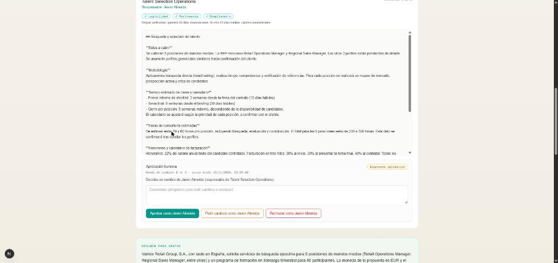
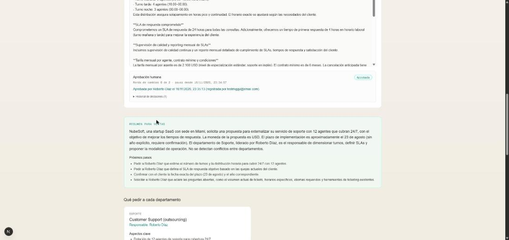
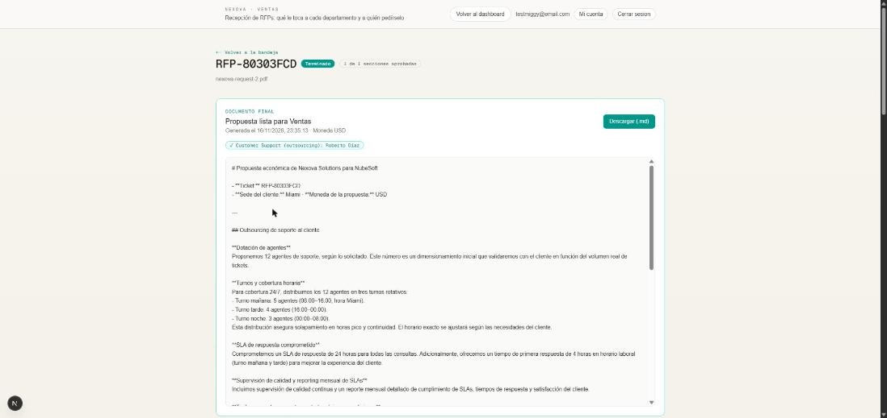
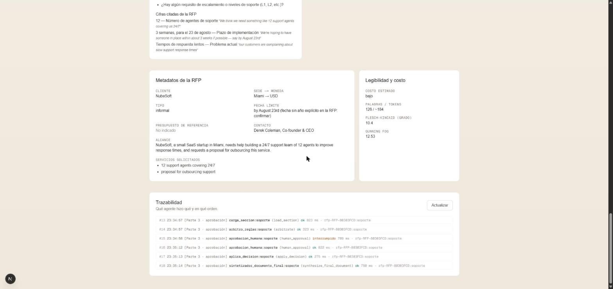

# RFP · Parte 3: evidencia de la prueba en Docker

Esta prueba se hizo el **2026-11-16**, con este entorno:

- Docker Desktop en Windows, con los contenedores `api` y `worker` reconstruidos con las dependencias de la Parte 3.
- El Supabase compartido, con la migración 010 aplicada.
- El checkpointer Postgres, a través del pooler de Supabase en modo transacción (puerto 6543).
- El backoffice en `localhost:3001`, manejado con Claude in Chrome.

Para la ruta reproducible sin infraestructura, ver `scripts/rfp_e2e.py` y `tests/pipelines/test_rfp_e2e.py`. El diseño está en `rfp-approval-design.md`.

## Resultado

| Ticket | Qué se probó | Resultado |
|---|---|---|
| `RFP-80303FCD` (NubeSoft, Miami) | Ciclo completo: "Abrir aprobaciones" → pausa de `soporte` → "Aprobar como Roberto Díaz" | Ticket en **`terminado`**, documento final en USD, aprobado por Roberto Díaz y registrado por el usuario real. Trazabilidad de 6 nodos en `rfp-RFP-80303FCD:soporte` |
| `RFP-EA6FA138` (Vantex, Madrid) | Ramas paralelas: se abren `seleccion` y `capacitacion`, y se aprueba capacitación con selección en pausa | Capacitación queda `aprobada` ("1 de 2 secciones aprobadas") y selección sigue en `human_approval`. Ticket en `esperando_aprobación`, sin documento final |
| `RFP-EA6FA138` | "Pedir cambios como Javier Almeida" en selección (vuelve al generador de la Parte 2 con el LLM real) | **No se completó:** el proveedor del LLM devolvió `403 Key limit exceeded (daily limit)`. La rama quedó en su checkpoint con `next = ['revise']` y la decisión ya registrada. Se retoma con `scripts/rfp_approve.py resume RFP-EA6FA138 --department seleccion` cuando haya cuota |

### Checkpoints en Supabase

Los hilos están separados por ticket y departamento:

| `thread_id` | Checkpoints |
|---|---|
| `rfp-RFP-80303FCD:soporte` | 7 |
| `rfp-RFP-EA6FA138:capacitacion` | 7 |
| `rfp-RFP-EA6FA138:seleccion` | 6 |

## Fallos encontrados en la prueba y corregidos

1. **`prepared statement "_pg3_0" does not exist` / `already exists`.**
   - El checkpointer usaba `prepare_threshold=0`, que en psycopg v3 significa preparar *todas* las sentencias.
   - El pooler de Supabase en modo transacción reparte las sentencias entre conexiones, así que las sentencias preparadas se pierden.
   - Arreglo: `prepare_threshold=None`.
2. **Carrera en `PostgresSaver.setup()`.**
   - Las dos ramas de Vantex arrancaron a la vez y las dos crearon las tablas `checkpoint*` (`UniqueViolation` en `checkpoint_migrations`).
   - Arreglo: `_setup()` reintenta ante un choque de DDL concurrente; `setup()` es idempotente.
   - Verificado con dos procesos en paralelo contra Supabase.
3. **Aviso viejo en la UI.**
   - Tras los reintentos fallidos, el ticket mostraba "intento 3 de 4 falló" aunque la rama ya estaba en pausa.
   - Arreglo: al llegar a la pausa o registrar una decisión, se limpia `error_message`.
   - Test: `test_reaching_the_pause_clears_stale_errors_from_failed_attempts`.
4. **La hora de inicio de la pausa se reiniciaba al reanudar.**
   - `human_approval` se re-ejecuta al reanudar, y con la sección en `procesando` reiniciaba `approval_requested_at`. Eso falsea el KPI de tiempo de aprobación por departamento.
   - Arreglo: se conserva la hora mientras sea la misma ronda.
   - Test: `test_resuming_keeps_the_original_pause_start_for_the_approval_time_kpi`.
   - En NubeSoft, después del arreglo: pausa a las 22:34:57 y aprobación a las 22:35:13 (UTC).
   - Las horas de pausa de Vantex se registraron antes del arreglo y quedaron reiniciadas.

## Capturas

| Qué muestra | Captura |
|---|---|
| Vantex: capacitación aprobada y selección todavía esperando a Javier Almeida |  |
| NubeSoft: panel de aprobación de soporte, aprobada por Roberto Díaz |  |
| NubeSoft: `terminado` con el documento final (USD) y descarga `.md` |  |
| NubeSoft: trazabilidad de la Parte 3 (pausa `interrumpido` y reanudación `ok` en el mismo hilo) |  |

## Pendiente

- Completar la ronda de cambios de Vantex/selección cuando el proveedor del LLM recupere cuota, y aprobarla después para llegar a `terminado`.
- Los tickets de esta prueba pasaron por las Partes 1 y 2 antes de que existiera la trazabilidad, así que su trace solo tiene eventos de la Parte 3. Una RFP subida a partir de ahora deja eventos de las tres partes; así lo muestra `scripts/rfp_e2e.py --trace`.
