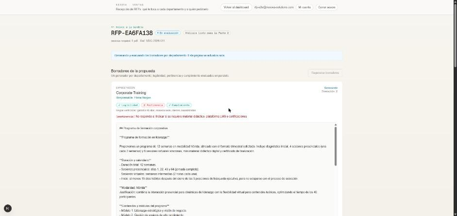
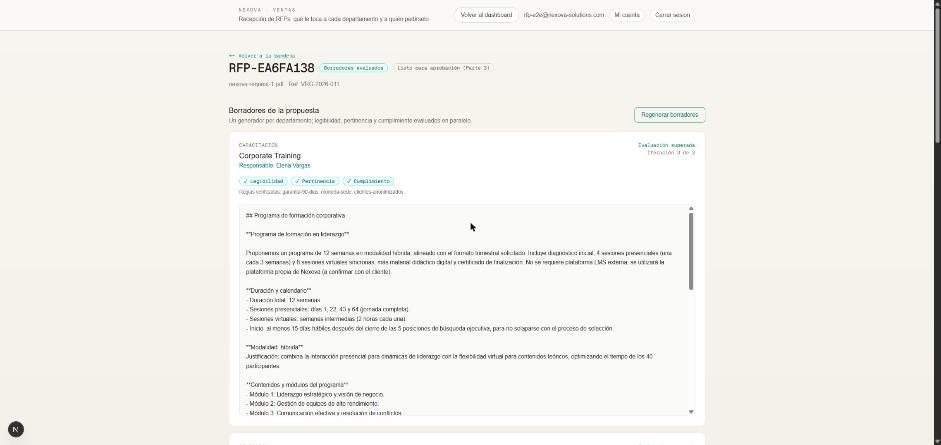
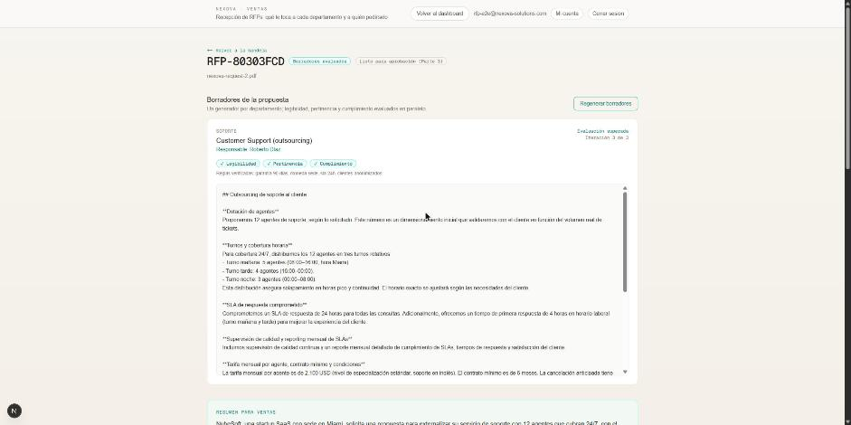
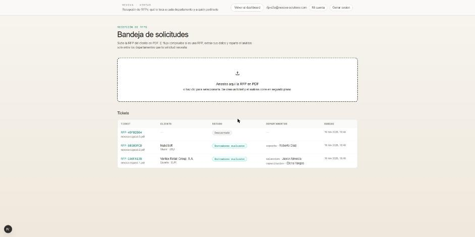

# Evidencia E2E — Generación y evaluación de respuestas (Hito 9 · Parte 2)

**Fecha:** 2026-11-16 · **Entorno:** Docker Desktop (Windows) con `api`, `worker`,
`redis`, `qdrant` y `uis`; Supabase compartido con la migración 009 aplicada
(dos veces, idempotente); modelo de generación de 4Geeks; base de conocimiento
en Qdrant (`nexova_knowledge`). Tickets de la Parte 1: `RFP-EA6FA138` (Vantex)
y `RFP-80303FCD` (NubeSoft).

## Cómo se disparó

| Ticket | Disparo | Resultado de `rfp.generate_responses` |
|---|---|---|
| `RFP-EA6FA138` (Vantex, España → EUR) | Botón **Regenerar borradores** en el detalle | `seleccion` pasa en la iteración 1; `capacitacion` en la 3 de 3. Ticket `en_evaluación` + `ready_for_approval`. 55,5 s |
| `RFP-80303FCD` (NubeSoft, Miami → USD) | Se relanzó su Parte 1 (`rfp.run_intake`): al terminar en `analisis_completo` **encoló sola** la Parte 2 (`drafting_task_id` en su resultado) | `soporte` pasa en la iteración 3. Ticket `en_evaluación` + `ready_for_approval`. 55,2 s |

En Supabase: `rfp_department_section` con `section_status = evaluada_ok`,
`iteration_count`, `iteration_history` (una entrada por vuelta), el último
`draft_content` y `evaluation_results`; `rfp_ticket.approval_handoff` con
`contract_version = rfp_drafting.v1` y `kpis` (`avg_iterations` 2,0 en Vantex y
3,0 en NubeSoft).

La UI mostró el progreso en vivo: el ticket en `En evaluación`, la tarjeta de
capacitación en "Generando · Iteración 2" con ✗ Pertinencia y el motivo, y al
terminar "Borradores evaluados · Listo para aprobación (Parte 3)" sin recargar.

## Ejemplo de sección que PASA — Vantex / `seleccion` (iteración 1)

`EvaluationResult`: legibilidad ✓, pertinencia ✓ (sin aspectos pendientes),
cumplimiento ✓ en `garantia-90-dias`, `moneda-sede`, `ttc-min-15-dias-habiles`
y `clientes-anonimizados`. Extracto del borrador:

> **Tiempo estimado de cierre y calendario**
> - Primer informe de shortlist: 3 semanas desde la firma del contrato (15 días hábiles).
> - Terna final: 6 semanas desde el briefing (30 días hábiles).
> - Cierre por posición: 8 semanas máximo, dependiendo de la disponibilidad de candidatos.
>
> **Honorarios y calendario de facturación**
> Honorarios: 22% del salario anual bruto del candidato contratado. Facturación en tres hitos: 30% al
> inicio, 30% al presentar la terna final, 40% al contratar. Todos los importes en EUR.
>
> **Garantía de satisfacción**
> Nexova ofrece una garantía de satisfacción de 90 días. […]

Las tarifas (22 %, 30/30/40) y el plazo de 6–8 semanas salen de la base de
conocimiento (RAG); la moneda, de la sede del cliente.

## Ejemplo de sección que FALLA — Vantex / `capacitacion` (iteración 1)

```json
{
  "section_id": "RFP-EA6FA138:capacitacion", "iteration": 1, "overall_pass": false,
  "readability": {"pass": true, "score": 15.9},
  "relevance": {"pass": false, "missing_aspects": [
    "Definir los contenidos y módulos del programa de liderazgo",
    "Calcular el esfuerzo en horas-hombre del equipo de capacitación para diseñar e impartir el programa"]},
  "compliance": {"pass": true, "rule_ids": ["garantia-90-dias", "moneda-sede", "clientes-anonimizados"], "violations": []}
}
```

`feedback_for_generator` enviado al generador de capacitación:

> Corrige lo siguiente y mantén lo que ya estaba bien:
> - [pertinencia] No respondes a: Definir los contenidos y módulos del programa de liderazgo. Cúbrelo con contenido concreto o como supuesto a confirmar.
> - [pertinencia] No respondes a: Calcular el esfuerzo en horas-hombre del equipo de capacitación para diseñar e impartir el programa. […]

En la iteración 2 añadió módulos y horas, pero le faltó "material didáctico,
plataforma LMS o certificaciones"; en la 3 lo cubrió y pasó.

## Ejemplo de fallo de CUMPLIMIENTO anclado al BRIEFING (test)

`tests/pipelines/test_rfp_compliance.py::test_promising_close_under_15_business_days_fails_compliance`:
un borrador de selección que dice *"Garantizamos el cierre de cada posición en
10 días hábiles."* → `compliance.pass == False` con la violación
`ttc-min-15-dias-habiles` (BRIEFING §5: ninguna búsqueda ejecutiva puede
comprometer menos de 15 días hábiles). En el grafo, ese mismo borrador vuelve
al generador con el feedback `[ttc-min-15-dias-habiles] Compromete un plazo de
cierre de '10 días hábiles' (≈10 días hábiles); el mínimo en búsqueda
ejecutiva es 15 días hábiles.` y, si agota el límite, la sección llega a la
Parte 3 como `needs_human_review` (`test_rfp_drafting_graph.py`).

## Observaciones

- **El que más rebota es pertinencia:** de las 4 iteraciones fallidas, las 4 fueron por aspectos sin
  cubrir; legibilidad y cumplimiento pasaron siempre. Las peticiones de la Parte 1 son muy granulares
  ("calcular horas-hombre", "plataforma LMS"), y eso eleva el KPI de iteraciones (2,0 y 3,0 frente al
  ideal < 2 del BRIEFING). Para bajarlo, los generadores podrían recibir esa lista como checklist
  explícito.
- **Primera respuesta más corta además del SLA:** el borrador de NubeSoft promete además "un tiempo de
  primera respuesta de 4 horas en horario laboral". Es compatible con el SLA de 24 h (adicional, no
  sustitutivo, como pide el prompt), pero conviene que Roberto Díaz lo valide en la Parte 3.
- **Poll tras "Regenerar":** la primera versión dejaba de consultar si el worker aún no había recogido
  la tarea. Ahora se sigue consultando hasta 30 s después del 202 o hasta ver el ticket en marcha.

## Capturas

| | |
|---|---|
| Vantex en evaluación: capacitación falla pertinencia (iteración 2) |  |
| Vantex terminado: borradores evaluados, listo para la Parte 3 |  |
| NubeSoft: soporte con SLA de 24 h en USD |  |
| Bandeja con los estados de la Parte 2 |  |
