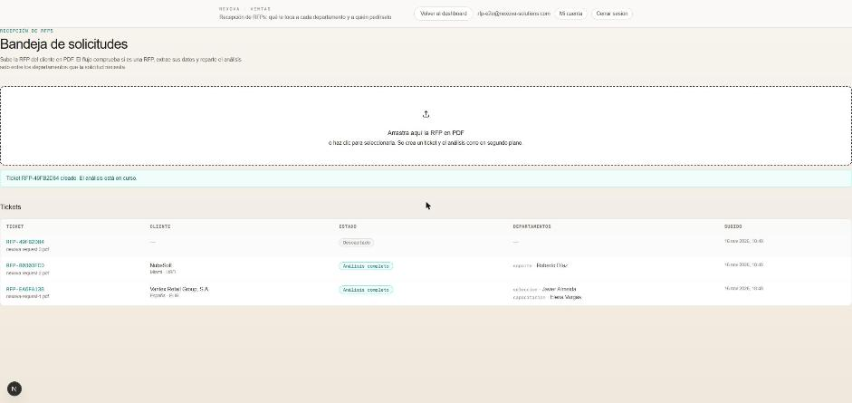
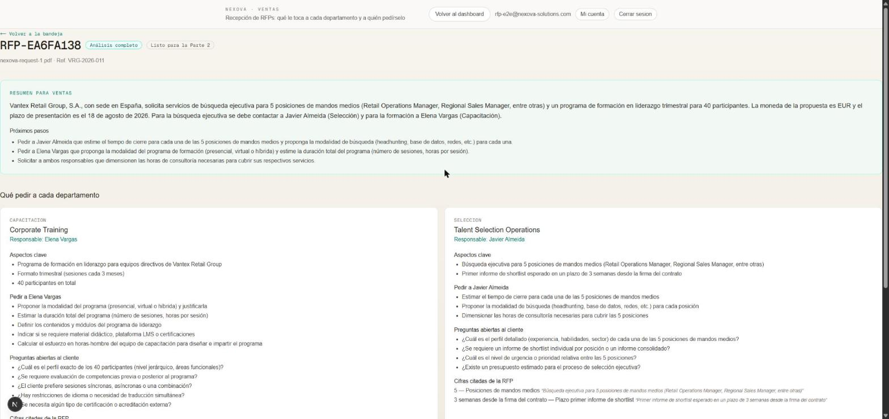
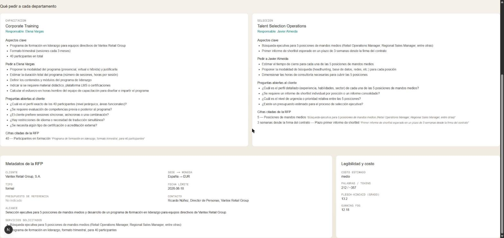
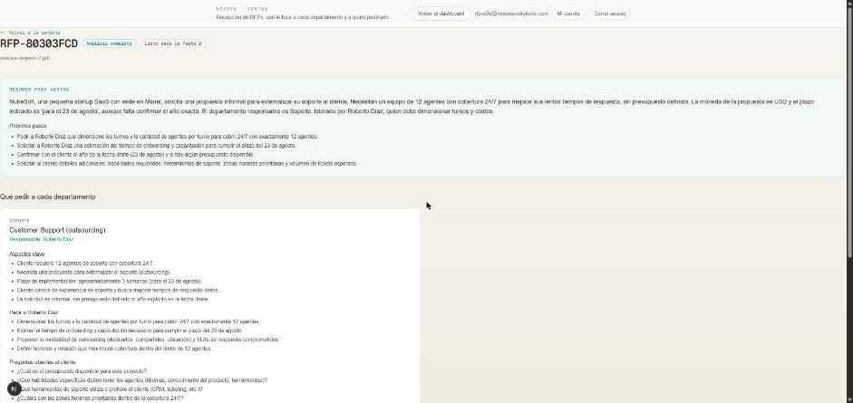
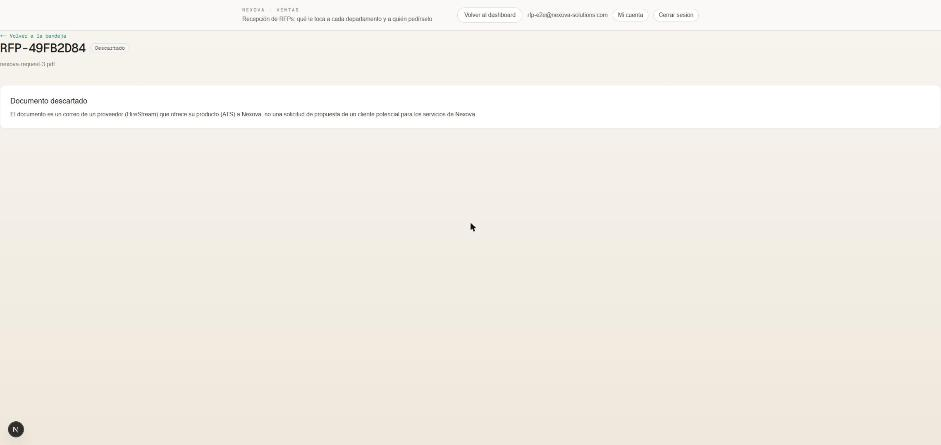

# Evidencia E2E — Recepción de RFPs (Hito 9 · Parte 1)

**Fecha:** 2026-11-16 · **Entorno:** Docker Desktop (Windows) con `api`, `worker`,
`redis`, `qdrant` y `uis`; Supabase compartido; modelo de generación de 4Geeks.
Subida por la UI (`http://localhost:3001/rfp`) con una cuenta de prueba local.

## Resultado por PDF del BRIEFING

| PDF | Ticket | Estado | Sede → moneda | Departamentos (responsable) | Duración en el worker |
|---|---|---|---|---|---|
| `nexova-request-1.pdf` (RFP formal, Vantex Retail Group) | `RFP-EA6FA138` | `analisis_completo` | España → EUR | `seleccion` (Javier Almeida), `capacitacion` (Elena Vargas) | 27,0 s |
| `nexova-request-2.pdf` (correo informal, NubeSoft) | `RFP-80303FCD` | `analisis_completo` | Miami → USD | `soporte` (Roberto Díaz) | 30,3 s |
| `nexova-request-3.pdf` (pitch de HireStream) | `RFP-49FB2D84` | `descartado` | — | — | 2,4 s |

Todos terminaron en el primer intento. Los tres tickets se subieron seguidos y
se procesaron en paralelo (worker con `--concurrency=2`). Después se subió
`nexova-request-3.pdf` tres veces más por la API para medir la latencia; los
tres quedaron `descartado` y después se borraron de Supabase y de `data/raw/rfp/`.

- **Subida asíncrona:** `POST /rfp/tickets` → 202 en 0,33–0,36 s (incluye el
  guardado del PDF en `data/raw/rfp/` y la creación del ticket en Supabase).
- **Estado en la UI:** la bandeja pasó de `Analizando` a `Análisis completo` /
  `Descartado` sin recargar (poll cada 3 s).
- **Persistencia (Supabase):** `create_db_and_tables()` creó `rfp_ticket`,
  `rfp_metadata` y `rfp_department_section` con sus restricciones
  (`ck_rfp_ticket_status`, `ck_rfp_section_department`,
  `uq_rfp_section_ticket_department`). Vantex: 2 secciones y 2 workstreams en el
  handoff; NubeSoft: 1 y 1; HireStream: sin metadatos ni secciones.

## Ejemplo para el PR: `nexova-request-1.pdf`

**Resumen para Ventas** (synthesizer):

> Vantex Retail Group, S.A., con sede en España, solicita servicios de búsqueda
> ejecutiva para 5 posiciones de mandos medios (Retail Operations Manager,
> Regional Sales Manager, entre otras) y un programa de formación en liderazgo
> trimestral para 40 participantes. La moneda de la propuesta es EUR y el plazo
> de presentación es el 18 de agosto de 2026. Para la búsqueda ejecutiva se debe
> contactar a Javier Almeida (Selección) y para la formación a Elena Vargas
> (Capacitación).

**Pedir a Javier Almeida (`seleccion`):** estimar el tiempo de cierre de cada una
de las 5 posiciones; proponer la modalidad de búsqueda por posición; dimensionar
las horas de consultoría. Cifras citadas: 5 posiciones; shortlist en 3 semanas
desde la firma.

**Pedir a Elena Vargas (`capacitacion`):** proponer la modalidad (presencial,
virtual o híbrida); estimar la duración total (sesiones y horas); definir
contenidos y módulos; calcular el esfuerzo del equipo. Cifra citada: 40
participantes.

**Handoff** (`rfp_ticket.handoff_payload`, `ready_for_drafting = true`):

```json
{"contract_version": "rfp_intake.v1", "ticket_id": "RFP-EA6FA138", "rfp_id": "VRG-2026-011",
 "client_hq": "España", "currency": "EUR", "deadline": "2026-08-18",
 "conflicts": [], "unmapped_services": [], "cost_tier": "medio",
 "workstreams": [{"department_id": "seleccion", "owner": "Javier Almeida", "...": "..."},
                 {"department_id": "capacitacion", "owner": "Elena Vargas", "...": "..."}]}
```

Legibilidad: 212 palabras, ~357 tokens, Flesch-Kincaid 13,2, Gunning Fog 12,18 →
costo `medio`.

## NubeSoft (`nexova-request-2.pdf`)

Aceptado como RFP informal. La fecha "August 23rd" no trae año: `deadline` queda
vacío y el worker lo convierte en pregunta abierta ("¿La fecha límite '23 de
agosto' corresponde a qué año?"). Cifra citada: 12 agentes 24/7.

**Observación:** el worker pide dimensionar turnos "con exactamente 12 agentes",
aunque el correo dice "something like 12". No inventa cifras, pero endurece el
matiz. A vigilar en el prompt de la Parte 2.

## Capturas

| | |
|---|---|
| Bandeja con los tres estados |  |
| Vantex: resumen y próximos pasos |  |
| Vantex: tarjetas por departamento, metadatos y legibilidad |  |
| NubeSoft: soporte (Roberto Díaz), USD |  |
| HireStream: descartado con motivo |  |
